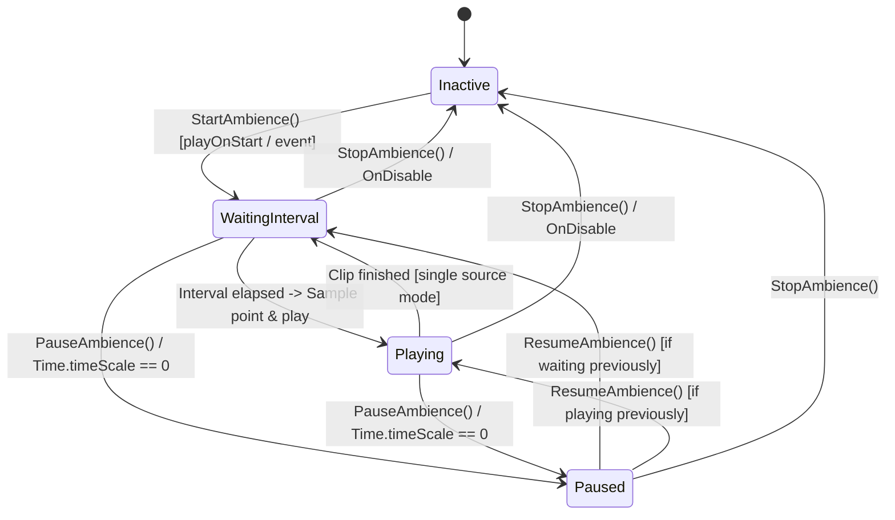

# Phase 1: Data Model & State Transitions

## 1. Entities & Structures

### `SpatialAmbientVolume` (MonoBehaviour)

Core component responsible for bounding volume detection, random point generation, interval scheduling, 3D audio playback, and AudioMixer routing.

#### Inspector Serialized Fields

| Group | Field | Type | Default | Description |
|---|---|---|---|---|
| **Parent Volume** | `parentCollider` | `Collider` | `null` | Target volume collider (`BoxCollider` or `SphereCollider`). If empty, resolves `GetComponentInParent<Collider>()` or `GetComponent<Collider>()`. |
| | `fallbackVolumeSize` | `Vector3` | `(10, 5, 10)` | Extents used if no parent collider is present in hierarchy. |
| **Audio Routing** | `channel` | `AudioChannel` | `AudioChannel.BGM` | Determines whether the sound routes to `BGM` or `SFX` AudioMixer group. |
| | `customAudioSource` | `AudioSource` | `null` | Optional template source. If empty, an internal 3D source is initialized automatically. |
| **Sound Clips** | `ambientClips` | `AudioClip[]` | `[]` | Array of audio clips (musical phrases, atmospheric stingers, ambient cues). |
| | `baseVolume` | `float` (0-1) | `0.7f` | Base playback volume. |
| | `volumeJitter` | `float` (0-0.2) | `0.05f` | Random volume variance (± jitter). |
| | `basePitch` | `float` (0.5-1.5) | `1.0f` | Base pitch. |
| | `pitchJitter` | `float` (0-0.2) | `0.05f` | Random pitch variance (± jitter). |
| **Timing & Flow** | `playOnStart` | `bool` | `true` | If true, starts the interval loop on `Start()`. |
| | `minInterval` | `float` | `8.0f` | Minimum delay in seconds between consecutive ambient plays. |
| | `maxInterval` | `float` | `20.0f` | Maximum delay in seconds between consecutive ambient plays. |
| | `pauseWithGame` | `bool` | `true` | Whether playback/timers pause when `Time.timeScale == 0`. |
| | `allowOverlap` | `bool` | `false` | Whether subsequent clips can play while a previous clip's tail is finishing. |
| **3D Spatial Sound**| `minDistance` | `float` | `2.0f` | Distance within which sound is at maximum volume. |
| | `maxDistance` | `float` | `25.0f` | Distance beyond which sound becomes inaudible. |
| | `rolloffMode` | `AudioRolloffMode`| `Logarithmic` | Distance attenuation curve. |
| **Unity Events** | `onAmbientStarted` | `UnityEvent` | - | Fired immediately when a clip begins playing at a sampled point. |
| | `onAmbientCompleted` | `UnityEvent` | - | Fired when the active clip finishes playing. |

---

### Supporting Types

#### `AudioChannel` (Enum)
```csharp
namespace Master.Scripts
{
    public enum AudioChannel
    {
        BGM,
        SFX
    }
}
```

#### `AmbientState` (Enum)
```csharp
public enum AmbientState
{
    Inactive,        // Volume stopped or disabled
    WaitingInterval, // Waiting for randomized delay to elapse
    Playing,         // Audio currently emitting at sampled point
    Paused           // Manually paused or paused via timeScale
}
```

---

## 2. Explicit State Transitions



### State Rules:
1. **`Inactive -> WaitingInterval`**:
   - Picks a random interval between `minInterval` and `maxInterval`.
   - Starts the scheduling coroutine.
2. **`WaitingInterval -> Playing`**:
   - Samples random 3D point in parent volume.
   - Moves child emitter to sampled point.
   - Selects clip without immediate repeat (`_lastClipIndex`).
   - Applies volume + pitch jitter.
   - Fires `onAmbientStarted.Invoke()`.
3. **`Playing -> WaitingInterval`**:
   - Clip finishes playback (`clip.length / pitch`).
   - Fires `onAmbientCompleted.Invoke()`.
   - Computes next interval and transitions to `WaitingInterval`.
4. **`* -> Inactive`**:
   - Halts all active scheduling coroutines.
   - Stops the audio source immediately (or fades out if smooth fade requested).
5. **`* -> Paused`**:
   - Stores pre-pause state.
   - Pauses `AudioSource` playback and timer.

---

## 3. Public Interface & UnityEvent Contracts

Parameterless methods adhering to Constitution Principle II (Designer-Centric Workflow):

```csharp
public void StartAmbience();
public void StopAmbience();
public void PauseAmbience();
public void ResumeAmbience();
public void TriggerRandomAmbient();
```

---

## 4. AudioManager Integration Contract

In `AudioManager.cs`:
```csharp
/// <summary>
/// Returns the AudioMixerGroup corresponding to the specified channel (BGM or SFX).
/// </summary>
public AudioMixerGroup GetChannelGroup(AudioChannel channel)
{
    if (channel == AudioChannel.BGM && bgmSource != null)
        return bgmSource.outputAudioMixerGroup;
    if (channel == AudioChannel.SFX && sfxSource != null)
        return sfxSource.outputAudioMixerGroup;

    var mixer = ResolveMixer();
    if (mixer != null)
    {
        var groups = mixer.FindMatchingGroups(channel.ToString());
        if (groups != null && groups.Length > 0) return groups[0];
    }
    return null;
}
```
